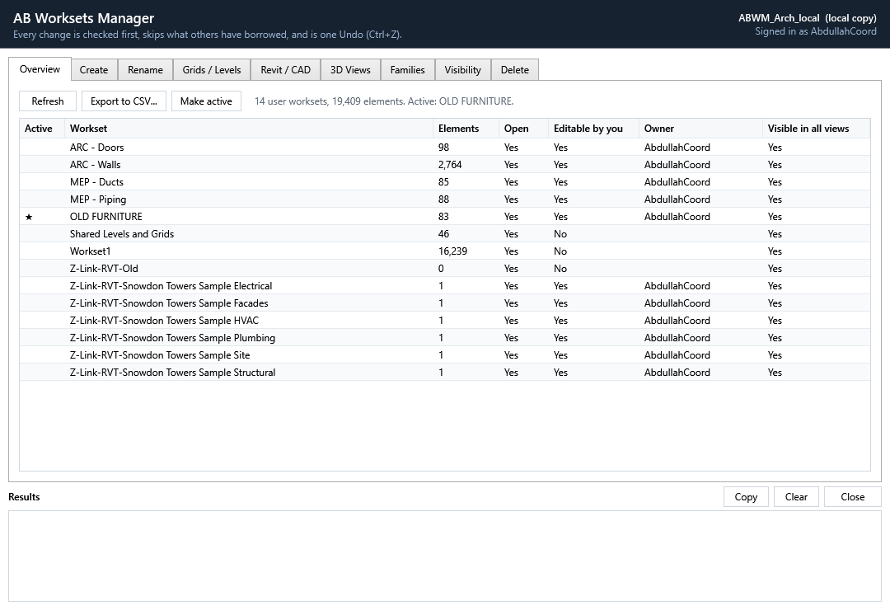

# AB Worksets Manager

A Revit add-in (Revit 2022 - 2027) for managing the worksets of workshared models, central or local,
file-based or cloud. Part of the **AB Adv Tools** suite: it sits on the shared **AB Adv Tools** ribbon tab
(panel *Worksets*, button *Worksets Manager*).



## What it does

| Tab | |
|---|---|
| **Overview** | Every user workset: element count, open/closed, editable, owner, *Visible in all views*, the active one. Export to CSV, make a workset active. |
| **Create** | Paste names (one per line, or from Excel) or load a `.txt` / `.csv`. *Check* says, per line, whether the workset is already in the model, a duplicate, or has characters Revit refuses - and lists worksets in the model that your list does not have. Create all or only the ticked ones, each with its *Visible in all views* setting. |
| **Rename** | Type new names in the grid, or load a two-column list (current name, new name). *Export list* gives a ready file to edit in Excel. Swaps (A->B, B->A) and capitals-only renames work. All renames happen together or none do. |
| **Grids / Levels** | Tick grids and levels (optionally scope boxes and reference planes) - all, the Revit selection, or picked in the model - and move them to *Shared Levels and Grids* or any workset. |
| **Revit / CAD** | Revit links, linked CAD and imported CAD. Move the ticked ones to a workset, or create a workset per link from a naming pattern (`Z-Link-RVT-{FileName}`, `Z-Link-CAD-{FileName}`, editable per row). A Revit link's **type moves with its instance** - the type's workset is what decides whether the link loads when that workset is closed. |
| **3D Views** | One combined 3D view of the ticked worksets, or one 3D view per workset (`3D - WS - {Workset}`). Each shows its worksets and hides every other. A 3D view with that name already in the model is updated, never duplicated. |
| **Families** | Every model element by category, family, type and current workset, with filters. Tick a whole category, a family, a type, or everything on one workset, and move it. Or pick elements in the model. Elements in a model group move with their whole group. |
| **Visibility** | Show / Hide / Use global setting for ticked worksets in ticked views and view templates. A view whose template controls worksets is skipped - or, if you choose, the template is changed. *Check status* gives a view x workset table (exportable). *Visible in all views* on/off. |
| **Delete** | Tick worksets, choose where their elements go, *Check*, then delete (type DELETE to confirm). Elements are moved first; only the empty worksets are deleted. |

## How it keeps the model safe

- **Checked before it changes anything.** Every action shows what it will do and asks first.
- **Never forces ownership.** Elements borrowed by another user, or changed in central since your last
  reload, are left alone and listed by name and owner. What can be changed is borrowed from central
  first, so one busy element never stops the rest.
- **One Undo per action, all or nothing.** Each action is one Revit transaction. Any Revit error rolls it
  back completely; Revit's warnings are listed in the results instead of popping up. The add-in never
  accepts a Revit "resolution" that would delete elements.
- **Light.** One button. Nothing runs until it is pressed; no events, no updaters, no background work.
  The window is modal, so the model cannot change underneath it.
- Not a workshared model? It says so and does nothing.

Revit 2022 needs **update 2022.1 or later** for *Delete* (Autodesk added workset deletion to the API in 2022.1).

## Install

`dist\AB.WorksetManager-<version>.msi` - a code-free Windows Installer package (company PCs with Defender
ASR rules install it like any .msi). *Only me* needs no administrator rights; *Everyone* is for IT.

```
msiexec /i AB.WorksetManager-1.0.0.msi /qn                 (Only me)
msiexec /i AB.WorksetManager-1.0.0.msi /qn ALLUSERS=1      (Everyone, as administrator)
msiexec /x AB.WorksetManager-1.0.0.msi /qn                 (remove)
```

## Build

```powershell
.\build\build-all.ps1            # self-test + every Revit release into artifacts\Release\Revit<year>
.\build\build-installer.ps1      # the .msi in dist\  (-DryRun shows what it would install, changing nothing)
dotnet run --project tests\AB.WorksetManager.Core.Tests
```

Needs the .NET 10 SDK; the Revit API comes from pinned reference packages, so no Revit is needed to build.
Development notes: [CLAUDE.md](CLAUDE.md).

By Abdullah Lotfy - [LinkedIn](https://www.linkedin.com/in/abdullahalqublawi/).
